# DSBs github CI/CD actions
Collection of DSB custom github actions for CI/CD.

## File index
```
ci-cd/
├───build-docker-image              --> Build, tag and push docker image
├───build-maven-project             --> Configure Java and build maven project
├───build-nodejs-project            --> Configure Node.js and build node project
├───build-python-project            --> Configure Python and build python project
├───build-spring-boot-image         --> Build spring boot OCI image with labels and tags
├───collect-build-envs              --> Collect build output from previous steps stored as workflow artifacts
├───comment-on-pr                   --> Add/update PR comment
├───configure-maven-settings        --> Create maven user settings (settings.xml)
├───create-app-vars-matrix          --> Create build/deploy vars for one or more DSB apps
├───create-build-envs               --> Create common DSB CI/CD variables
├───delete-pr-images-from-acr       --> Delete ephemeral PR image repository from ACR
├───deploy-to-ephemeral             --> Deploy DSB app to ephemeral environment
├───deploy-to-static                --> Deploy DSB app to static environment
├───notify-internal-status          --> Send status update to internal API
├───prune-images-from-acr           --> Prune images from ACR
├───prune-maven-artifacts-in-repo   --> Prune maven artifacts from GitHub packages
├───require-build-envs              --> Test DSB build environment variables for non-zero values
└───teardown-pr-environment         --> Tear down ephemeral PR environment in AKS
```

## Usage and doc

These actions are used by the CI/CD workflow(s) in [./workflows](../workflows). For example usage see their usage in those workflows.

For documentation refer to the `description` section of each specific actions as well as comments within their definition.

### Permissions

The calling workflow must grant the following permissions:

```yaml
permissions:
  contents: read        # required for actions/checkout
  pull-requests: write  # required for commenting on PRs
  actions: write        # required to be able to delete GitHub caches in the calling repo
  checks: write         # required for publish-unit-test-result-action
  packages: write       # required for maven deploy to GitHub Packages
  id-token: write       # required for GitHub artifact attestation (OIDC token)
  attestations: write   # required for writing build provenance attestations
  security-events: write # required for uploading CodeQL and detekt SARIF results
  code-quality: write   # required for uploading code coverage
```

Alternatively, `permissions: write-all` can be used as a shorthand which covers all of the above.

### Artifact attestation

Build provenance and SBOM attestations are automatically created using [`actions/attest`](https://github.com/actions/attest):

- **Docker images** (via `build-docker-image` and `build-spring-boot-image`) — build provenance attestation is pushed to the container registry as an OCI referrer. If an SBOM is provided by the upstream build step, a CycloneDX SBOM attestation is also pushed to the registry.
- **Maven artifacts** (via `build-maven-project`) — build provenance and CycloneDX SBOM attestations are stored on GitHub's attestation API, linked to the artifact's SHA-256 digest. The SBOM is also passed to the downstream Docker image build for image-level attestation.
- **npm projects** (via `build-nodejs-project`) — a CycloneDX SBOM is generated and passed to the downstream Docker image build, where it is attested against the image digest.

Attestations are created for both PR/snapshot and release builds.

#### Verification

```bash
# Docker images — build provenance
gh attestation verify oci://<registry>/<repo>/<image>:<tag> --owner dsb-norge

# Docker images — SBOM
gh attestation verify oci://<registry>/<repo>/<image>:<tag> --owner dsb-norge --predicate-type "https://cyclonedx.org/bom"

# Maven artifacts (downloaded from GitHub Packages)
gh attestation verify <artifact.jar> --owner dsb-norge
```

#### Self-hosted runner network requirements

Artifact attestation requires outbound HTTPS (443) access to Sigstore endpoints from the runner. These are not documented by GitHub but are defined in the [`@actions/attest` source code](https://github.com/actions/toolkit/blob/main/packages/attest/src/endpoints.ts):

| Endpoint | Purpose |
|----------|---------|
| `fulcio.githubapp.com` | Signing certificate issuance (private repos) |
| `timestamp.githubapp.com` | Timestamp authority (private repos) |
| `fulcio.sigstore.dev` | Signing certificate issuance (public repos) |
| `rekor.sigstore.dev` | Transparency log (public repos) |

### npm package firewall

All npm packages, in `build-nodejs-project` and in the Playwright image build, are fetched through [GitHub package firewall](https://docs.github.com/en/code-security/how-tos/secure-your-supply-chain/secure-your-dependencies/protecting-endpoints-with-package-firewall) for enterprise `dsb-no`, authenticated with `github.token`. The firewall enforces the enterprise policies (malware, vulnerabilities, cooldown for new versions, etc.).

- Runners need outbound HTTPS (443) to `package-firewall.githubapp.com`.
- npm dependencies are not cached: a restored `~/.npm` would serve packages without asking the firewall.
- There are no private npm packages, so no npm token is used. Keep it that way: npmjs is for public packages only.
- A blocked package fails the build with `403 ... blocked by security policy`. The npm log links to a bypass request; usually the fix is to update the dependency instead.
- `package-lock.json` may only resolve packages from `registry.npmjs.org` (fetched through the firewall) or from `file:` paths in the repo. Any other host, such as a CDN tarball or a git dependency, fails `build-nodejs-project` before `npm ci`. A package published outside npm (e.g. SheetJS `xlsx` on `cdn.sheetjs.com`) is vendored: commit the tarball and depend on `file:vendor/<name>.tgz`.

### Code scanning (CodeQL)

CodeQL runs as part of the build for `spring-boot` (java-kotlin), `vue` (javascript-typescript), `python` and `maven-library` apps, with the `code-quality` query suite on top of the security queries. Maven-based apps with Kotlin sources additionally get [detekt](https://detekt.dev/) findings uploaded to code scanning, see [detekt](#detekt).

In `ci-cd-default.yml` the Java/Kotlin analysis of `spring-boot` apps runs in its own `codeql` job, in parallel with `build-deploy`, rather than tracing the regular build. That job calls `build-maven-project` with `build-only: true`, which runs `clean package -DskipTests` (keeping `maven-build-project-arguments`) and skips test reporting, artifact deploy, attestation and SBOM. The regular build and its tests thus run without the tracer, and the analysis is off the critical path. The `codeql` job is not part of `ci-cd-conclusion`, so it never blocks a build.

#### Kotlin version guard

Java/Kotlin analysis uses `build-mode: manual`, which means CodeQL's tracer injects itself into `kotlinc` during the Maven build it follows. When the project's Kotlin version is newer than the installed CodeQL bundle supports, the extractor throws before compilation:

```
com.semmle.extractor.java.interceptors.KotlinInterceptor$KotlinVersionTooRecentError:
  Kotlin version 2.4.20 is too recent. CodeQL currently supports versions below 2.4.20
```

That failure lands in the Maven build step, so `continue-on-error` on the CodeQL steps does not contain it — the whole build and deploy fails. `build-maven-project` therefore compares the project's Kotlin version against the extractors the installed bundle ships (`2_codeql-kotlin-guard.ts`) and sets `CODEQL_EXTRACTOR_JAVA_AGENT_DISABLE_KOTLIN=true` when CodeQL cannot handle it. The build then proceeds, Java code is still analyzed, and Kotlin analysis resumes by itself once a CodeQL bundle with support for that Kotlin version is released. The guard logs a warning when it kicks in, and never fails the build itself.

#### detekt

detekt runs for every `spring-boot` and `maven-library` app that contains Kotlin sources (`*.kt` outside `target`/`build`), in `ci-cd/run-detekt`:

- When the app has a `detekt.yml` in its `application-source-path`, that config is used.
- Otherwise the DSB default config [`run-detekt/detekt-default.yml`](run-detekt/detekt-default.yml) is used. It is tuned for Spring Boot services (constructor injection, controllers with many endpoints, guard clauses), turns off pure formatting rules (line length, wildcard imports, trailing newline) and only lists deviations from detekt's defaults.

Either config is applied on top of detekt's own default config (`--build-upon-default-config`). To start from the DSB defaults and adjust them, copy `detekt-default.yml` into the app as `detekt.yml`. Findings are uploaded to code scanning and never fail the build.

### Code coverage

`spring-boot` and `maven-library` apps upload their test coverage to [GitHub code coverage](https://docs.github.com/en/code-security/how-tos/maintain-quality-code/set-up-code-coverage), which shows coverage of changed lines on pull requests. `ci-cd/upload-code-coverage` picks up every JaCoCo XML report the Maven build left below `application-source-path` (`**/target/**/jacoco*.xml`), merges them (a line is covered when any report covers it, so separate unit and integration test reports are fine) and converts the result to Cobertura XML, the only format GitHub accepts.

Requirements for coverage to show up:

- The pom runs `jacoco-maven-plugin` with the `prepare-agent` and `report` goals, so the build writes `target/site/jacoco/jacoco.xml`. Without a report the step is skipped.
- The calling workflow grants `code-quality: write` (included in `permissions: write-all`).
- Code coverage is enabled for the repository in its Code Quality settings.
- The runner has the GitHub CLI (`gh`) and `python3`, which `actions/upload-code-coverage` uses.

Uploads are best effort: a missing permission or a disabled setting produces an error annotation, not a failed build.

Note that on pull requests the build runs on the merge commit, while GitHub maps coverage onto the PR head commit. Line numbers only differ for files the base branch changed after the PR branched off, where coverage of a few lines may be shown off by some lines.

#### Opting out per application

Set any of these on an app in `apps` to skip the corresponding analysis for it. Both the YAML boolean and the quoted string `"false"` are accepted:

| Flag | Skips |
|------|-------|
| `codeql-enabled: false` | CodeQL init and analysis, and with it detekt, whose findings are uploaded to code scanning through `codeql-action/upload-sarif` |
| `detekt-enabled: false` | detekt only |
| `coverage-enabled: false` | Code coverage upload |

```yaml
apps: |
  - application-name: my-app
    codeql-enabled: false
```

The values are normalized to real booleans by `create-build-envs` and default to `true`, so the workflows can test them directly in an `if:` expression. That matters: an app var that is not set reads as `null`, and GitHub casts both `null` and boolean `false` to `0` when comparing, which makes `!= false` impossible to express correctly.

### Static environments

On a push to the default branch, the `deploy-to-static` job of `ci-cd-default.yml` deploys every app to the environments in its `static-deploy-environments` (default `dev`): it bumps the app's image tag in `apps/<env>/<app>/values.yaml` of `app-config-repo`, and Argo CD does the rest.

#### Keeping an app out of them

Set `static-deploy-skip: true` on an app in `apps` to leave it out. The app is still built, its image pushed and the commit tagged with its version, but no static environment is bumped to it, so each keeps the version it runs. Both the YAML boolean and the quoted string `"true"` are accepted; `create-build-envs` normalizes the value to a boolean that defaults to `false`. When every app in the run is left out, the job skips the deploy and makes no commit in `app-config-repo`.

```yaml
apps: |
  - application-name: my-app
    static-deploy-skip: true
    pr-deploy-skip: true
```

- An empty `static-deploy-environments` does not do this: it falls back to the default, `dev`.
- To stop PR environments too, also set `pr-deploy-skip: true`, as above. It must be the YAML boolean, and no image is built for the app on pull requests then, unless `pr-image-build` is set (below).

### PR images for a PR environment elsewhere

An app with `pr-deploy-skip: true` gets no PR environment in dev and, by default, no image on pull requests. Set `pr-image-build: true` as well to build and push its PR image anyway, for a caller that deploys the pull request somewhere else. Both the YAML boolean and the quoted string `"true"` are accepted; it defaults to `false`, and changes nothing for an app without `pr-deploy-skip`, whose image is built anyway.

```yaml
apps: |
  - application-name: my-app
    static-deploy-skip: true
    pr-deploy-skip: true
    pr-image-build: true
```

On a pull request that is not closed, the `pr-images` job lists what was pushed, and `ci-cd-default.yml` gives it to the caller as outputs:

| Output | Value |
| --- | --- |
| `applications-version` | The version every app in the run is built as, which is also the tag of its images: `pr-<number>-<date>.<seconds>` on a pull request |
| `pr-images` | JSON object `{"<application-name>": {"image": "<registry>/<repo>/<app>-pr-<number>", "tag": "<version>"}}`, one entry per app with changes whose PR image was built; `{}` when there is none, empty when the job did not run |

An app without changes gets no new image and is left out; the caller deploys the version it already runs. The PR images are deleted from the registry when the pull request closes, as before.

```yaml
jobs:
  ci-cd:
    uses: dsb-norge/github-actions/.github/workflows/ci-cd-default.yml@v4
    # ...
  pr-environment:
    needs: ci-cd
    if: github.event_name == 'pull_request' && github.event.action != 'closed'
    # ... reads ${{ needs.ci-cd.outputs.pr-images }}
```

### ci-cd-gitops.yml: for app repos moving to the new GitOps repo

`.github/workflows/ci-cd-gitops.yml` is `ci-cd-default.yml` for app repos whose envs move to a new GitOps repo, `dsb-norge/azure-kubernetes-ikt-app-platform-apps-config`, laid out `apps/<app>/<env>/`. It takes the same inputs, plus `pr-environments`, and does what `ci-cd-default.yml` does for every env that still lives in the old repo. `ci-cd-default.yml` is not changed by it, and its callers depend on nothing new.

```yaml
jobs:
  ci-cd:
    # was: dsb-norge/github-actions/.github/workflows/ci-cd-default.yml@v4
    uses: dsb-norge/github-actions/.github/workflows/ci-cd-gitops.yml@v4
    secrets: inherit
    permissions: write-all
    with:
      apps: |
        - application-name: my-app
```

- **Where each env lives is decided on every run.** `create-matrix` asks the new repo whether it has `apps/<application-name>/<env>/` on its default branch, for `dev`, `test` and `prod`. It reads the repo with a token from the org's CI/CD App, scoped to that repo. If the directory is there the env lives in the new repo, where Argo CD reads it; if not, in the old one.
  - The step logs the answer per app.
  - Any answer from GitHub other than the directory or "not found" fails the run, rather than writing to the wrong repo.
  - An app name that can't be a directory there fails the run too.
- **Switching changes nothing.** While all of an app's envs live in the old repo, this workflow does what `ci-cd-default.yml` does, so an app repo can switch any time before its env moves.
- **Moving an env changes no app repo.** An env moves when its conversion pull request merges into the new repo, creating `apps/<app>/<env>/` for every app. From the next run on, every app repo on this workflow takes the new repo's way for that env. So every app repo that deploys to an env must be on this workflow before that env moves.
- **Static environments.** On a push, each app's `static-deploy-environments` in the old repo are deployed as before. Those in the new repo are left out of the old repo's commit, with a notice. The new repo's way, a pull request on `bump/<app>/<env>` that changes only `tag.yaml`, is added to this workflow later; until then nothing is deployed there by it.
- **PR environments.** By default, as before: the PR environment in dev, while dev lives in the old repo. Once dev has moved, dev's PR environments run through `pr-environment.yml` too, in a job added then.
- **`pr-environments: test`, opted into per repo for now.** An app whose test env lives in the new repo, without `pr-deploy-skip: true`, gets its PR environment in test instead of dev. It runs through the reusable workflow `pr-environment.yml` in `dsb-infra/entra-id-terraform-ikt-app-platform-app-registrations`.
  - The app's PR image is built as before.
  - Its `pr-deploy-additional-helm-values` is ignored, since the PR environment is derived from the app's config in the new repo; the run logs which apps that applies to.
  - The job `pr-environment-test` runs after `pr-images`, on `opened`, `synchronize`, `reopened` and `closed`. It passes `apps` (those apps, by name), `images` (`pr-images`, cut down to them) and `pr-number`, and on `closed` it tears the PR environment down.
  - Bots' pull requests get none. The job's result counts in `ci-cd-conclusion`.
  - Only `test` is accepted; another value fails the run.
- **The caller** must be a private repository of the enterprise, grant `id-token: write`, `contents: read` and `pull-requests: write` (`write-all` covers them), and pass `secrets: inherit`.
  - GitHub reads every called workflow, and checks its access and permissions, when a run starts and before any job's `if`. So this holds for every caller of `ci-cd-gitops.yml`, with or without `pr-environments`.
  - That is why `pr-environment.yml` is called from this file and not from `ci-cd-default.yml`.
- **The Azure identities this workflow signs in as** (ACR push and delete, and dev's AKS for PR environments) must trust this workflow file, as they trust `ci-cd-default.yml`.
- **The end shape.**
  - After dev has moved: the old dev PR environment and dev's old-repo deploy come out of this file.
  - After prod has moved: the routing and the old repo's deploy come out, and `ci-cd-default.yml` is retired once no repo calls it.
  - What is left is the new repo's way alone: build, a `tag.yaml` update, and PR environments through `pr-environment.yml`.

## Maintenance

### Development

How you test changes before merging depends on what you've touched. In both cases the caller repo's workflow points at your **branch name** (not a tag) so each new commit you push is automatically picked up on the next CI run.

#### Scenario A: workflow-only changes (`.github/workflows/*.yml`)

If your change only touches the reusable workflows themselves and not the underlying `ci-cd/*` actions, no rewriting is needed inside this repo.

1. Push your changes to a feature branch (e.g. `my-feature-branch`).
2. In the calling repo, change the `uses:` ref of the reusable workflow from `@v4` to your branch name:

   ```yaml
   jobs:
     ci-cd:
       # TODO revert to '@v4'
       uses: dsb-norge/github-actions/.github/workflows/ci-cd-default.yml@my-feature-branch
   ```
3. Push the change in the calling repo and let CI run. Iterate by pushing new commits on your feature branch — the next CI run in the calling repo picks them up automatically.
4. Before merging your PR here, the calling repo reverts `@my-feature-branch` back to `@v4`.

#### Scenario B: changes that also touch `ci-cd/*` actions or `get-github-app-installation-token`

The reusable workflows' internal `uses: dsb-norge/github-actions/ci-cd/*@v4` references will still resolve to the **stable `@v4`** tag — so your action changes won't be picked up by callers unless you also rewrite those internal refs in your branch.

1. In your branch, rewrite every internal `@v4` ref to point at your branch name. Replace regex pattern for VSCode:
   - Find: `(^\s*)((- ){0,1}uses: dsb-norge/github-actions/.*@)v4`
   - Replace: `$1# TODO revert to @v4\n$1$2my-feature-branch`
2. Commit and push.
3. Point the calling repo at your branch name (as in Scenario A) and iterate.
4. **Before merging**, revert all internal `@my-feature-branch` refs back to `@v4`. Replace regex pattern for VSCode:
   - Find: `(^\s*# TODO revert to @v4\n)(^\s*)((- )?uses: dsb-norge/github-actions/.*@)my-feature-branch`
   - Replace: `$2$3v4`

#### Optional: pin to a movable tag instead of a branch

For scenarios where you want snapshot semantics — multiple people testing the same commit simultaneously, or freezing your test target while you iterate on something else — create a movable tag and reference `@my-feature` in place of the branch name:

```bash
git tag -f -a 'my-feature'
git push -f origin 'refs/tags/my-feature'
```

Move the tag with the same commands after each new commit. Delete when done:

```bash
git tag --delete 'my-feature'
git push --delete origin 'my-feature'
```

For solo iterative testing, branch-pinning is enough.

### Release

After merge to main use tags to release.

#### Minor release

Ex. for smaller backwards compatible changes. Add a new minor version tag (e.g. `v4.5`) with a description of the changes and amend the description to the major version tag.

Example for release `v4.5`:
```bash
git checkout origin/main
git pull origin main
# review latest release tag to determine which is the next one
git tag --sort=-creatordate | head -n 5
# output changes since last release
git log v4..HEAD --pretty=format:"%s"
git tag -a 'v4.5'
# you are prompted for the tag annotation (change description)
git tag -f -a 'v4'
# you are prompted for the tag annotation, amend the change description
git push -f origin 'refs/tags/v4.5'
git push -f origin 'refs/tags/v4'
```

**Note:** If you are having problems pulling main after a release, try to force fetch the tags: `git fetch --tags -f`.

#### Major release

Same as minor release except that the major version tag is a new one. I.e. we do not need to force tag/push.

Example for release `v5`:
```bash
git checkout origin/main
git pull origin main
# review latest release tag to determine which is the next one
git tag --sort=-creatordate | head -n 5
# output changes since last release
git log v4..HEAD --pretty=format:"%s"
git tag -a 'v5.0'
# you are prompted for the tag annotation (change description)
git tag -a 'v5'
# you are prompted for the tag annotation
git push -f origin 'refs/tags/v5.0'
git push -f origin 'refs/tags/v5'
```

**Note:** If you are having problems pulling main after a release, try to force fetch the tags: `git fetch --tags -f`.


#### Un-release (move major tag back)

In case of trouble where a fix takes long time to develop, this is how to rollback the major tag to the previous minor release.

Example un-release `v4.5` and revert to `v4.4`:
```bash
git checkout origin/main
git pull origin main

moveTag='v4'
moveToTag='v4.4'
moveToHash=$(git rev-parse --verify ${moveToTag})

git push origin "refs/tags/${moveTag}"      # delete the old tag remotely
git tag -fa ${moveTag} ${moveToHash}        # move tag locally
git push -f origin "refs/tags/${moveTag}"   # push the updated tag remotely

```

**Note:** If you are having problems pulling main after a release, try to force fetch the tags: `git fetch --tags -f`.

## CI/CD Workflow Diagram

The following flowchart visualizes the entire CI/CD pipeline, showing all major steps and their dependencies:

```mermaid
flowchart TD
    %% Start
    start([Start Workflow])

    %% Create matrix job
    subgraph createMatrixJob["Create Build Matrix Job (create-matrix)"]
        createMatrix["create-app-vars-matrix"]
        matrixOutput(("App Vars Matrix"))
        createMatrix --> matrixOutput
    end

    %% Build-deploy job (matrix)
    subgraph buildDeployJob["Build-Deploy Job (Matrix) (build-deploy)"]
        getToken["get-github-app-installation-token"]
        createEnvs["create-build-envs"]
        buildEnvsOutput(("Build Envs"))
        cacheRestore["dependencies-cache-restore"]
        appTypeCheck{App Type?}
        mavenBuild["build-maven-project"]
        mavenDockerBuild["build-spring-boot-image"]
        npmBuild["build-nodejs-project"]
        npmDockerBuild["build-docker-image"]
        cachePrune["Prune Own Artifacts From Cache"]
        cacheSave["Save Dependencies Cache"]
        eventTypeCheck{Event Type?}
        ephemeralDeploy["deploy-to-ephemeral"]
        teardownPR["teardown-pr-environment"]
        pruneImages["prune-images-from-acr"]
        deletePRImages["delete-pr-images-from-acr"]
        deletePRCaches["delete-pr-github-caches"]

        getToken --> createEnvs --> buildEnvsOutput --> cacheRestore --> appTypeCheck
        appTypeCheck -- "spring-boot" --> mavenBuild --> mavenDockerBuild
        appTypeCheck -- "vue" --> npmBuild --> npmDockerBuild
        mavenDockerBuild --> cachePrune --> cacheSave
        npmDockerBuild --> eventTypeCheck
        cacheSave --> eventTypeCheck
        eventTypeCheck -- "PR" --> ephemeralDeploy
        eventTypeCheck -- "PR closed" --> teardownPR --> deletePRImages --> deletePRCaches
        eventTypeCheck -- "push/manual" --> pruneImages
    end

    %% CodeQL job (matrix, spring-boot apps only), in parallel with build-deploy
    subgraph codeqlJob["CodeQL Job (Matrix) (codeql)"]
        codeqlEnvs["create-build-envs"]
        codeqlCache["dependencies-cache-restore"]
        codeqlInit["codeql-action/init"]
        codeqlBuild["build-maven-project (build-only)"]
        codeqlAnalyze["codeql-action/analyze"]
        codeqlEnvs --> codeqlCache --> codeqlInit --> codeqlBuild --> codeqlAnalyze
    end

    %% AND join node for jobs that require both createMatrixJob and buildDeployJob
    andDeployStatic["<b>Waits for both jobs</b>"]
    andPruneMaven["<b>Waits for both jobs</b>"]

    %% Deploy to static job
    subgraph deployStaticJob["Deploy to Static Job (deploy-to-static)"]
        collectEnvs["collect-build-envs"]
        deployCheck["deploy-multiple-to-static-is-allowed"]
        skipFilter["Leave out apps with static-deploy-skip"]
        getTokenStatic["get-github-app-installation-token"]
        staticDeploy["deploy-multiple-to-static"]
        versionTag["Add Git Version Tag"]
        collectEnvs --> deployCheck -- "allowed" --> skipFilter -- "apps left" --> getTokenStatic --> staticDeploy --> versionTag
        skipFilter -- "none left" --> versionTag
    end

    %% PR images job (pull requests only)
    subgraph prImagesJob["PR Images Job (pr-images)"]
        prCollectEnvs["collect-build-envs"]
        prImagesList["List the images pushed for the pull request"]
        prCollectEnvs --> prImagesList
    end

    %% Prune Maven artifacts job
    subgraph pruneMavenJob["Prune Maven Artifacts Job (prune-maven-artifacts)"]
        pruneArtifacts["prune-maven-artifacts-in-repo"]
    end

    %% Final conclusion
    conclusion([CI/CD Conclusion])

    %% Job dependencies (needs)
    start --> createMatrixJob
    matrixOutput -.-> buildDeployJob
    matrixOutput -.-> codeqlJob
    createMatrixJob --|waits on|--> andDeployStatic
    buildDeployJob --|waits on|--> andDeployStatic
    andDeployStatic --> deployStaticJob
    createMatrixJob --|waits on|--> andPruneMaven
    buildDeployJob --|waits on|--> andPruneMaven
    andPruneMaven --> pruneMavenJob
    buildDeployJob -- "pull request" --> prImagesJob
    prImagesJob --> conclusion
    deployStaticJob --> conclusion
    pruneMavenJob --> conclusion
    buildDeployJob --> conclusion

    %% Notes
    %% - The AND nodes visually clarify that deployStaticJob and pruneMavenJob only start after both upstream jobs finish
    %% - Arrow labels and dummy nodes are used to clarify 'waits on' semantics
```



This diagram now uses labeled arrows and explicit AND nodes to clarify that jobs like "deploy-to-static" and "prune-maven-artifacts" only start after both upstream jobs are complete. Box labels have also been adjusted for better visibility.
